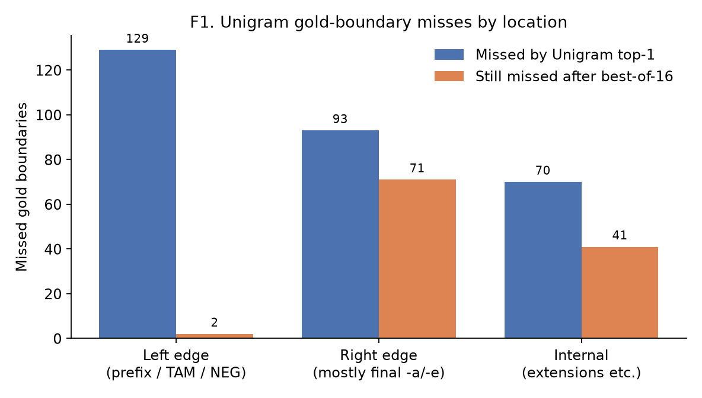
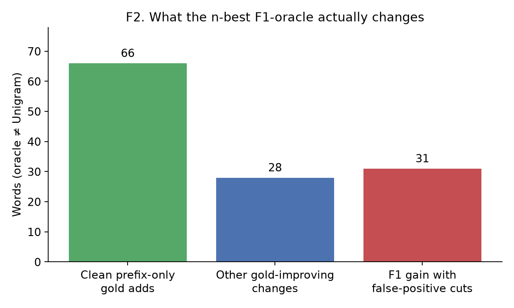
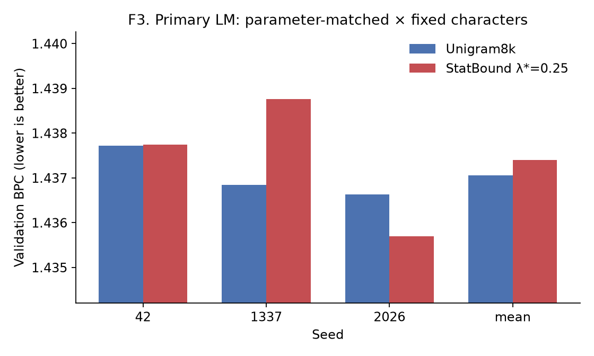

# Mthandizi — controlled Chichewa tokenization experiments

A reproducible research record for **tokenization of Chichewa**, a low-resource Bantu language, under frozen data, compute, and evaluation locks.

The active goal is **not** to invent another tokenizer. It is to document what the finished experiments already show, and to support a small empirical paper / technical report.

> **One-sentence finding.** Unigram substantially outperforms BPE on a conservative native-speaker Chichewa morphology benchmark but undersegments; its n-best list already contains most missing prefix/TAM/NEG structure, while many final-vowel and internal boundaries are absent, and a pre-registered unsupervised boundary-productivity reranker fails both to select the unused alternatives and to improve matched LM BPC.

**Status:** unpublished research repository.  
**Direction:** D-0016 — empirical consolidation; no V2.  
**Morphology holdout:** locked.  
**LM test:** locked.

Charter: [`docs/research/EMPIRICAL_PAPER_CHARTER_v0_1.md`](docs/research/EMPIRICAL_PAPER_CHARTER_v0_1.md)

---

## 1. What this repository is

This is a small research lab repository. Experiments follow:

```text
reproduce → measure → change one thing → measure again
```

The Mthandizi track studies **whether standard subword tokenizers, and one pre-registered unsupervised boundary reranker, align with conservative Chichewa morphology** and with a matched small language-model protocol.

It is **not** a claim of a novel tokenizer, a state-of-the-art model, or “the first Chichewa tokenizer.”

---

## 2. Motivation

Agglutinative Bantu languages are often discussed as if finer morphological tokenization would automatically help language models. That assumption is empirical, not definitional.

This project measures, on frozen Chichewa data:

- how **BPE** and **Unigram** compare on a conservative morphology instrument;
- **where** Unigram undersegments, and which of those misses already exist in its n-best list;
- whether a simple **train-only boundary-productivity reranker** (StatBound V1) can use that list;
- whether that intervention changes **primary LM BPC**.

Morphological faithfulness and efficient LM tokenization are **not** treated as the same objective.

---

## 3. One-sentence finding

Unigram substantially outperforms BPE on a conservative native-speaker Chichewa morphology benchmark but undersegments; its n-best list already contains most missing prefix/TAM/NEG structure, while many final-vowel and internal boundaries are absent, and a pre-registered unsupervised boundary-productivity reranker fails both to select the unused alternatives and to improve matched LM BPC.

Working paper draft: [`docs/research/papers/unigram_undersegments_chichewa_v0_1.md`](docs/research/papers/unigram_undersegments_chichewa_v0_1.md) · [PDF](docs/research/papers/unigram_undersegments_chichewa_v0_1.pdf)

Paper-facing tables and figures: [`data/reports/paper_artifacts_v0_1.md`](data/reports/paper_artifacts_v0_1.md)

---

## 4. Data

| Item | Value |
|------|--------|
| Corpus | Chichewa corpus v0.1 (Bible + Wikipedia) |
| Splits | Frozen train / validation / test |
| Tokenizer vocabularies | 8k BPE, 8k Unigram, character |
| Normalization | Identity (same as the Unigram baseline) |

Train text is the only source for Unigram/BPE training and for StatBound boundary statistics.  
**Validation** is used for LM BPC and efficiency.  
**Test is locked** and has not been used for scientific claims.

Provenance notes live under [`data/`](data/). Third-party corpora keep their own licenses.

---

## 5. Morphology benchmark

A conservative **Level-B** development benchmark: split namable grammatical morphology; keep the safest derived stem when finer cuts are uncertain; do not cut on syllable shape alone.

| Fact | Status |
|------|--------|
| Annotated development records | 200 |
| Annotator | Single native Chichewa speaker (`annotator_a`) |
| Level-B active items | **162** |
| Excluded (non-Chichewa / noise) | **33** |
| Unresolved / reconstruction failures | 0 |
| Policy | [`docs/research/CHICHEWA_LEVEL_B_ADJUDICATION_POLICY_v0_2.md`](docs/research/CHICHEWA_LEVEL_B_ADJUDICATION_POLICY_v0_2.md) |
| Active file SHA-256 | `73b948d782b6e979814de051ffad315ca282cbff5fc7f8c5de15b0c864852f67` |
| Morphology holdout | **Locked / unused** |

This is a **single-annotator development instrument**. It is not multi-annotator gold and does not report human–human IAA. Historical Stage-1 self-review numbers (exact 0.52, boundary F1 0.841) are preserved as measurements of the earlier protocol and are **not** recomputed as current gold quality.

Tokenizer outputs were not used to write the Level-B gold.

---

## 6. Frozen evaluation protocol

| Document | Role |
|----------|------|
| [`docs/research/MTHANDIZI_TOKENIZER_SUCCESS_CRITERIA_v0_1.md`](docs/research/MTHANDIZI_TOKENIZER_SUCCESS_CRITERIA_v0_1.md) | SC1–SC9, frozen before StatBound implementation |
| [`docs/research/MTHANDIZI_TOKENIZER_EVALUATION_PROTOCOL_v0_1.md`](docs/research/MTHANDIZI_TOKENIZER_EVALUATION_PROTOCOL_v0_1.md) | Phase order, λ selection, locks |
| [`docs/research/MTHANDIZI_TOKENIZER_DECISION_LOG.md`](docs/research/MTHANDIZI_TOKENIZER_DECISION_LOG.md) | Dated decisions D-0001–D-0016 |
| [`docs/research/EMPIRICAL_PAPER_CHARTER_v0_1.md`](docs/research/EMPIRICAL_PAPER_CHARTER_v0_1.md) | Current paper/repo direction |

In force:

- Frozen splits and 8k vocabulary scale  
- Parameter-matched **and** architecture-matched LM tracks  
- Fixed-character (primary) **and** fixed-update (diagnostic) budgets  
- Three seeds: 42, 1337, 2026  
- Primary LM metric: **validation BPC** (SC1)  
- Morphology λ/α selection **must not** use BPC  
- Development morphology is **not** confirmatory holdout evidence  
- Negative results are kept; criteria are not rewritten after seeing numbers  

---

## 7. Tokenizer baselines

| Tokenizer | Role |
|-----------|------|
| Character | Efficiency / fragmentation diagnostic only |
| SentencePiece **BPE-8000** | Standard subword baseline |
| SentencePiece **Unigram-8000** | **Strongest standard baseline** on both Level-B F1 and validation LM |

**T1. Level-B development morphology (162 items)**

| system | P | R | F1 | exact | TPC |
|--------|--:|--:|---:|------:|----:|
| BPE8k | 0.7015 | 0.3764 | 0.4622 | 0.0556 | 0.2285 |
| Unigram8k | 0.8431 | 0.4502 | **0.5551** | 0.0802 | 0.2281 |

Unigram’s dominant failure is **undersegmentation**: high precision, low recall.

Source: [`data/reports/phase_c_morphology_v0_2_results.json`](data/reports/phase_c_morphology_v0_2_results.json)

---

## 8. StatBound-Unigram V1 — closed negative result

V1 was a pre-registered inference-time reranker of Unigram n-best=16:

```text
score(S | w) = unigram_score(S | w) + λ · boundary_compatibility(S, w)
```

Boundary strengths were estimated from **train text only**. No morphological analyzer, no gold labels in learning, no extra vocabulary. Frozen λ grid: `{0, 0.25, 0.5, 1.0, 2.0}`. λ=0 is an ordinary-Unigram control. Selected λ*=0.25 by the frozen efficiency-then-F1 tie-break (all nonzero λ had identical F1).

**T2. StatBound V1 vs Unigram**

| | Unigram8k | StatBound λ*=0.25 |
|--|----------:|------------------:|
| development boundary F1 | 0.5551 | 0.5551 |
| benchmark words changed | 0 | **0** |
| primary validation BPC | 1.437061 ± 0.000582 | 1.437402 ± 0.001559 |
| ΔBPC (SB − Unigram) | — | +0.000341 |
| seeds beating Unigram | — | 1/3 |
| SC4 morphology | — | **FAIL** |
| SC1 primary LM | — | **FAIL** |

V1 is **closed** (D-0013–D-0015). Do not retune λ, RelBound, or otherwise rescue V1.

The compatibility signal does **not** identify morphology-better n-best alternatives (41/115 higher compat; 73/115 equal; max-compat F1 0.5169, worse than Unigram).

Historical spec: [`docs/research/MTHANDIZI_TOKENIZER_V1_SPEC.md`](docs/research/MTHANDIZI_TOKENIZER_V1_SPEC.md)

---

## 9. N-best oracle and error anatomy

Gold was used **only** to score already generated Unigram n-best=16 candidates. The oracle is not a tokenizer and is not a training target.

**T3. Availability vs selection**

| system | P | R | F1 | exact |
|--------|--:|--:|---:|------:|
| Unigram top-1 | 0.8431 | 0.4502 | 0.5551 | 13/162 |
| Best-of-16 F1 oracle | 0.8315 | 0.8107 | 0.7913 | 22/162 |

Oracle ΔF1 = **+0.2362**. Exact gold appears in n-best for only 22/162 items. This ceiling is **not** a realistic method target: some F1 gains are linguistically poor oversegmentations.

**F1. Where Unigram misses gold cuts**



| zone | Unigram misses | still missing after best-of-16 |
|------|---------------:|-------------------------------:|
| Left edge (prefix / TAM / NEG) | 129 | **2** |
| Right edge (mostly final `-a`/`-e`) | 93 | **71** |
| Internal (extensions etc.) | 70 | 41 |

**F2. What the oracle actually changes** (125 words)



- **66** clean prefix-only gold adds  
- **28** other gold-improving changes  
- **31** F1 gains that introduce false-positive cuts  
- **124/125** oracle changes only add splits; the oracle effectively never merges  

**Interpretation.** Prefix-stack alternatives are mostly a **selection** problem (already in n-best). Many final-vowel and internal cuts are a **generation** problem (absent from n-best=16).

**F3. Primary LM (parameter-matched × fixed characters)**



StatBound did not improve mean BPC (1/3 seeds better). Because it changed 0/162 development segmentations, this is not evidence about “more morphological tokenization” as an LM intervention.

Oracle report: [`data/reports/unigram_nbest_oracle_v0_1.md`](data/reports/unigram_nbest_oracle_v0_1.md)

---

## 10. Current conclusions

1. **Unigram ≫ BPE** on this conservative Chichewa Level-B development instrument.  
2. Unigram **undersegments** (P 0.84, R 0.45).  
3. Its n-best list already contains **most missing left-edge inflection**; many **final-vowel** and some **internal** gold cuts are not in that list.  
4. Some high-F1 n-best paths are **linguistically bad**. Do not imitate the oracle.  
5. A simple unsupervised **productivity reranker fails** to select the unused alternatives and fails primary LM BPC.  
6. Morphological boundary F1 and LM BPC should **not** be treated as one objective.

---

## 11. Limitations

- Single annotator; N=162; Bible-heavy development sample  
- Morphology numbers are **development** evidence; holdout unused  
- Level-B is a conservative linguistic rubric, not automatically the right LM unit  
- V1 was a scientific no-op on the benchmark, so Phase F does not test morphologically different tokenization  
- Small decoder LM, not a large pretrained model  
- No multi-annotator IAA  

---

## 12. Reproducibility

Regenerate the six paper artifacts from frozen reports (no training):

```bash
.venv/bin/python scripts/tokenizers/render_paper_artifacts_v0_1.py
```

Re-run the analysis-only n-best oracle (development gold only):

```bash
.venv/bin/python scripts/tokenizers/run_unigram_nbest_oracle_v0_1.py
```

Verify train-only boundary-stat regeneration:

```bash
.venv/bin/python scripts/tokenizers/verify_boundary_stats_repro.py
```

Unit tests:

```bash
.venv/bin/python -m unittest tests.test_unigram_nbest_oracle tests.test_statbound_unigram_v1 tests.test_phase_c_infra
```

| Path | Contents |
|------|----------|
| [`configs/`](configs/) | Frozen criteria, StatBound config, eval protocol hashes |
| [`data/reports/`](data/reports/) | Phase C/F, oracle, paper artifacts |
| [`data/reports/figures/paper_v0_1/`](data/reports/figures/paper_v0_1/) | F1–F3 |
| [`docs/research/`](docs/research/) | Specs, protocol, decision log, charter |
| [`scripts/tokenizers/`](scripts/tokenizers/) | Evaluation, oracle, artifact renderer |
| [`src/tokenizers/statbound/`](src/tokenizers/statbound/) | Frozen V1 implementation |

**Environment used here:** Python 3.12.3, SentencePiece 0.2.0, PyTorch 2.11.0+cu128. Hardware notes are not performance claims.

Remote: https://github.com/HystonKayange/research-lab

---

## 13. Future work (not started)

The only method direction currently supported by the evidence is narrow and **optional**:

> Can Unigram be made to emit inflectional prefix stacks that already exist in n-best=16, without promoting linguistically bad extra cuts?

That is **not** required for this project to be finished. No successor tokenizer is authorized (D-0016).

---

## 14. Status

| Stage | Status |
|-------|--------|
| Corpus, baselines, LM validation matrix | Complete |
| Level-B development benchmark v0.2 | Frozen (162 / 33) |
| StatBound V1 | **Closed, negative** |
| Phase C / Phase F | Complete |
| N-best oracle + anatomy | Complete |
| Paper artifacts T1–T3, F1–F3 | Generated from existing results |
| Empirical paper draft | **Working draft v0.1** (markdown + PDF) |
| Morphology holdout | **Locked** |
| LM test | **Locked** |
| V2 / new tokenizer | **Not authorized** |

---

## What this README does not claim

- a novel or state-of-the-art tokenizer  
- that StatBound improves language models or morphology  
- “first Chichewa tokenizer” as methodological novelty  
- multi-annotator gold  
- that the 0.79 oracle F1 is an achievable fair-method result  
- any holdout or LM-test number  

---

## Data and redistribution

This repository is **public**. Source corpora may have their own licenses. Publishing this code does not relicense third-party data. No project-wide open-source license is declared here.

Credentials, LM-test split files, and the sealed morphology-holdout artifacts belong in private local storage and are excluded from new commits. The research locks remain in force. Older commits previously included the protected research files; removing them from the current tree does not erase those historical copies. See [SECURITY.md](SECURITY.md) for the safeguards and remaining exposure limits.

Before committing, install `requirements-security.txt` in a separate `.venv-security` environment as described in [SECURITY.md](SECURITY.md). To enable the check automatically for local commits, set `git config core.hooksPath .githooks`. GitHub also runs the public-repository check on pushes and pull requests.
