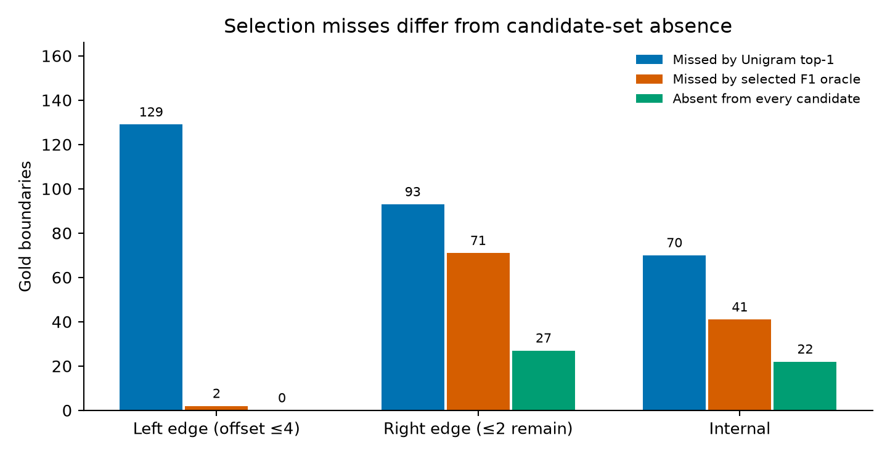
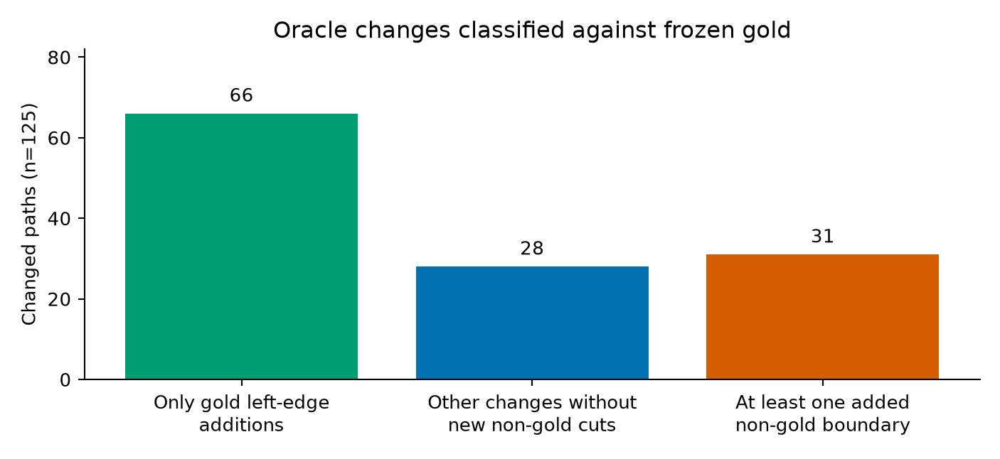
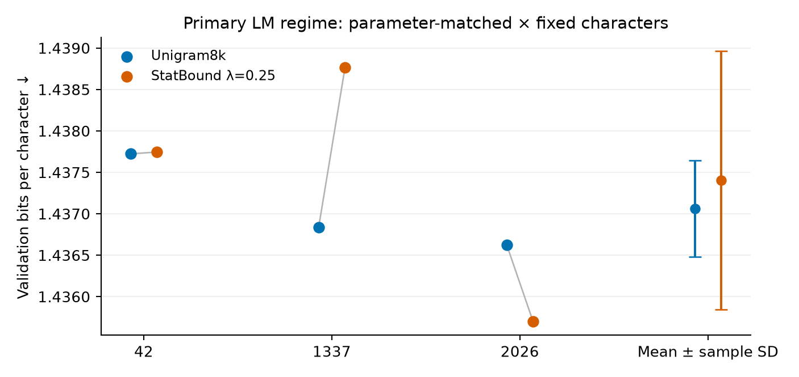

# Mthandizi — controlled Chichewa tokenization experiments

A research record for **tokenization of Chichewa**, a low-resource Bantu language, under frozen data, compute, and evaluation locks. Paper artifacts can be rebuilt from the published result files; full experimental reproduction has additional data and checkpoint requirements.

The active goal is **not** to invent another tokenizer. It is to document what the finished experiments already show, and to support a small empirical paper / technical report.

> **Finding.** Unigram has higher logged morphology F1 than BPE on the frozen Chichewa development instrument and still undersegments. Stored candidates contain all missed left-edge offsets and many missed right-edge/internal offsets, but availability is different from selecting a good complete path. StatBound V1 changes none of the development segmentations and fails the primary LM criterion. The v0.2 report discloses conditional scoring denominators, normalization warnings, and prior public test-artifact exposure.

**Status:** unpublished research repository.  
**Direction:** D-0016 — empirical consolidation; no V2.  
**Morphology holdout:** locked.  
**LM test:** locked.

Charter: [`docs/research/EMPIRICAL_PAPER_CHARTER_v0_1.md`](docs/research/EMPIRICAL_PAPER_CHARTER_v0_1.md)

---

## 1. What this repository is

This is a small research lab repository. Experiments follow:

```text
reproduce → measure → change one thing → measure again
```

The Mthandizi track studies **whether standard subword tokenizers, and one pre-registered unsupervised boundary reranker, align with conservative Chichewa morphology** and with a matched small language-model protocol.

It is **not** a claim of a novel tokenizer, a state-of-the-art model, or “the first Chichewa tokenizer.”

---

## 2. Motivation

Agglutinative Bantu languages are often discussed as if finer morphological tokenization would automatically help language models. That assumption is empirical, not definitional.

This project measures, on frozen Chichewa data:

- how **BPE** and **Unigram** compare on a conservative morphology instrument;
- **where** Unigram undersegments, and which of those misses already exist in its n-best list;
- whether a simple **train-only boundary-productivity reranker** (StatBound V1) can use that list;
- whether that intervention changes **primary LM BPC**.

Morphological faithfulness and efficient LM tokenization are **not** treated as the same objective.

---

## 3. One-sentence finding

Unigram has higher logged development boundary F1 than BPE (0.5551 versus 0.4622), but misses 292 gold offsets. All 129 missed left-edge offsets occur somewhere in its stored candidate list. Of the 93 right-edge and 70 internal misses, 27 and 22 respectively are absent from every candidate. A gold-selected path can still omit an available boundary. StatBound's frozen λ*=0.25 changes no development segmentation and fails primary LM validation.

Current working paper: [v0.2 Markdown](docs/research/papers/unigram_undersegments_chichewa_v0_2.md) · [seven-page PDF](docs/research/papers/unigram_undersegments_chichewa_v0_2.pdf). The [v0.1 draft](docs/research/papers/unigram_undersegments_chichewa_v0_1.md) is retained as a historical version; its stronger candidate-absence wording is corrected in v0.2.

Current data summary and figures: [publication snapshot v0.2](data/reports/publication_snapshot_v0_2.json) · [figures](data/reports/figures/paper_v0_2/). Historical T1–T3/F1–F3: [v0.1 artifacts](data/reports/paper_artifacts_v0_1.md).

---

## 4. Data

| Item | Value |
|------|--------|
| Corpus | Chichewa corpus v0.1 (Bible + Wikipedia) |
| Splits | Frozen train / validation / test |
| Tokenizer vocabularies | 8k BPE, 8k Unigram, character |
| Normalization | Identity (same as the Unigram baseline) |

Train text is the only source for Unigram/BPE training and for StatBound boundary statistics.  
**Validation** is used for LM BPC and efficiency.  
**LM test remains procedurally locked**; the paper reports LM validation results. Test artifacts were previously public and were removed from published history. This is not a claim that historical confidentiality or an unseen test set was restored.

Provenance notes live under [`data/`](data/). Third-party corpora keep their own licenses.

---

## 5. Morphology benchmark

A conservative **Level-B** development benchmark: split namable grammatical morphology; keep the safest derived stem when finer cuts are uncertain; do not cut on syllable shape alone.

| Fact | Status |
|------|--------|
| Annotated development records | 200 |
| Excluded before Level-B review | 5 |
| Active Level-B source records | 195 |
| Annotator | Single native Chichewa speaker (`annotator_a`) |
| Level-B active items | **162** |
| Further excluded under Level-B scope/source criteria | **33** |
| Unresolved / reconstruction failures | 0 |
| Policy | [`docs/research/CHICHEWA_LEVEL_B_ADJUDICATION_POLICY_v0_2.md`](docs/research/CHICHEWA_LEVEL_B_ADJUDICATION_POLICY_v0_2.md) |
| Active file SHA-256 | `73b948d782b6e979814de051ffad315ca282cbff5fc7f8c5de15b0c864852f67` |
| Morphology holdout | **Locked / unused** |

This is a **single-annotator development instrument**. It is not multi-annotator gold and does not report human–human IAA. Historical Stage-1 self-review numbers (exact 0.52, boundary F1 0.841) are preserved as measurements of the earlier protocol and are **not** recomputed as current gold quality.

Finalization retained 18 original analyses, accepted 133 frozen-policy revisions, and incorporated explicit native-speaker decisions on 11 flagged exceptions. This is not evidence of an independent human reannotation of every policy revision.

Tokenizer outputs were not used to write the Level-B gold.

---

## 6. Frozen evaluation protocol

| Document | Role |
|----------|------|
| [`docs/research/MTHANDIZI_TOKENIZER_SUCCESS_CRITERIA_v0_1.md`](docs/research/MTHANDIZI_TOKENIZER_SUCCESS_CRITERIA_v0_1.md) | SC1–SC9, frozen before StatBound implementation |
| [`docs/research/MTHANDIZI_TOKENIZER_EVALUATION_PROTOCOL_v0_1.md`](docs/research/MTHANDIZI_TOKENIZER_EVALUATION_PROTOCOL_v0_1.md) | Phase order, λ selection, locks |
| [`docs/research/MTHANDIZI_TOKENIZER_DECISION_LOG.md`](docs/research/MTHANDIZI_TOKENIZER_DECISION_LOG.md) | Dated research, publication, and provenance decisions |
| [`docs/research/EMPIRICAL_PAPER_CHARTER_v0_1.md`](docs/research/EMPIRICAL_PAPER_CHARTER_v0_1.md) | Current paper/repo direction |

In force:

- Frozen splits and 8k vocabulary scale  
- Parameter-matched **and** architecture-matched LM tracks  
- Fixed-character (primary) **and** fixed-update (diagnostic) budgets  
- Three seeds: 42, 1337, 2026  
- Primary LM metric: **validation BPC** (SC1)  
- Morphology λ/α selection **must not** use BPC  
- Development morphology is **not** confirmatory holdout evidence  
- Negative results are kept; criteria are not rewritten after seeing numbers  

---

## 7. Tokenizer baselines

| Tokenizer | Role |
|-----------|------|
| Character | Efficiency / fragmentation diagnostic only |
| SentencePiece **BPE-8000** | Standard subword baseline |
| SentencePiece **Unigram-8000** | **Strongest standard baseline** on both Level-B F1 and validation LM |

**T1. Level-B development morphology (162 items)**

| system | P | R | F1 | exact | TPC |
|--------|--:|--:|---:|------:|----:|
| BPE8k | 0.7015 | 0.3764 | 0.4622 | 0.0556 | 0.2285 |
| Unigram8k | 0.8431 | 0.4502 | **0.5551** | 0.0802 | 0.2281 |

Unigram’s dominant logged error is **undersegmentation**: 292 false-negative boundaries versus 64 false positives. Macro P/R/F1 omit undefined values separately: Unigram uses 152/160/150 items; exact match uses 162. The frozen integrity record also flags one BPE and three Unigram empty normalized pieces despite exact surface reconstruction. Scores and rules are preserved, with these qualifications disclosed in the v0.2 paper.

Source: [`data/reports/phase_c_morphology_v0_2_results.json`](data/reports/phase_c_morphology_v0_2_results.json)

---

## 8. StatBound-Unigram V1 — closed negative result

V1 was a pre-registered inference-time reranker of Unigram n-best=16:

```text
score(S | w) = unigram_score(S | w) + λ · boundary_compatibility(S, w)
```

Boundary strengths were estimated from **train text only**. No morphological analyzer, no gold labels in learning, no extra vocabulary. Frozen λ grid: `{0, 0.25, 0.5, 1.0, 2.0}`. λ=0 is an ordinary-Unigram control. Selected λ*=0.25 by the frozen efficiency-then-F1 tie-break (all nonzero λ had identical F1).

**T2. StatBound V1 vs Unigram**

| | Unigram8k | StatBound λ*=0.25 |
|--|----------:|------------------:|
| development boundary F1 | 0.5551 | 0.5551 |
| benchmark words changed | 0 | **0** |
| primary validation BPC | 1.437061 ± 0.000582 | 1.437402 ± 0.001559 |
| ΔBPC (SB − Unigram) | — | +0.000341 |
| seeds beating Unigram | — | 1/3 |
| SC4 morphology | — | **FAIL** |
| SC1 primary LM | — | **FAIL** |

V1 is **closed** (D-0013–D-0015). Do not retune λ, RelBound, or otherwise rescue V1.

The compatibility signal does **not** identify morphology-better n-best alternatives (41/115 higher compat; 73/115 equal; max-compat F1 0.5169, worse than Unigram).

Historical spec: [`docs/research/MTHANDIZI_TOKENIZER_V1_SPEC.md`](docs/research/MTHANDIZI_TOKENIZER_V1_SPEC.md)

---

## 9. N-best oracle and error anatomy

Gold was used **only** to score already generated Unigram n-best=16 candidates. The oracle is not a tokenizer and is not a training target.

**T3. Availability vs selection**

| system | P | R | F1 | exact |
|--------|--:|--:|---:|------:|
| Unigram top-1 | 0.8431 | 0.4502 | 0.5551 | 13/162 |
| Best-of-16 F1 oracle | 0.8315 | 0.8107 | 0.7913 | 22/162 |

Logged oracle ΔF1 = **+0.2362**, with the conditional-denominator caveat above. Exact gold appears in n-best for 22/162 items. This is an analysis ceiling, not a deployable method target: some selected paths add non-gold boundaries.

**F1. Candidate availability versus selected-path misses**



| Positional bin | Unigram misses | Selected oracle still misses | Absent from every candidate |
|------|---------------:|-------------------------------:|---:|
| Left edge (offset ≤4) | 129 | **2** | **0** |
| Right edge (≤2 characters remain) | 93 | **71** | **27** |
| Internal | 70 | 41 | **22** |

**F2. What the oracle actually changes** (125 words)



- **66** paths add only gold left-edge offsets
- **28** other changes without new non-gold cuts
- **31** paths introduce an additional non-gold boundary
- **124/125** changes only add boundaries; one also removes a boundary

**Interpretation.** These coordinate bins are not independently labelled grammatical categories. Candidate absence is 0/27/22, not the selected oracle's 2/71/41 misses. Union coverage does not establish that all cuts coexist in one candidate. Of 125 changed paths, 115 strictly improve defined F1; ten have undefined baseline F1. The 31 extra-cut cases are a mechanical gold comparison, not 31 independent native-speaker judgments.

**F3. Primary LM (parameter-matched × fixed characters)**



StatBound did not improve mean BPC (1/3 seeds better). It changed 0/162 development segmentations, so these results do not establish the LM effect of improved morphology. Broader-text encoding was not completely identical.

Oracle report: [`data/reports/unigram_nbest_oracle_v0_1.md`](data/reports/unigram_nbest_oracle_v0_1.md)

---

## 10. Current conclusions

1. **Unigram ≫ BPE** on this conservative Chichewa Level-B development instrument.  
2. Unigram **undersegments** (P 0.84, R 0.45).  
3. Its stored candidate union contains all missed left-edge offsets; **27 right-edge** and **22 internal** gold offsets are absent. Joint selection remains a separate problem.
4. Some higher-F1 n-best paths introduce **non-gold cuts**. The oracle is not a pseudo-gold training target.
5. A simple unsupervised **productivity reranker fails** to select the unused alternatives and fails primary LM BPC.  
6. Morphological boundary F1 and LM BPC should **not** be treated as one objective.

---

## 11. Limitations

- Single annotator; N=162; Bible-heavy development sample  
- Morphology numbers are **development** evidence; holdout unused  
- Level-B is a conservative linguistic rubric, not automatically the right LM unit  
- V1 changed no benchmark segmentation; the study does not establish the effect of a successful morphology intervention on LM quality
- Small decoder LM, not a large pretrained model  
- No multi-annotator IAA  
- Conditional macro denominators and empty normalized-piece warnings in the frozen scorer
- Prior public test-artifact exposure; procedural locks are not a confidentiality claim
- Original archives and a proven immutable Wikipedia dump identifier are unavailable

---

## 12. Reproducibility

Build the current paper artifacts from frozen reports in a separate presentation environment:

```bash
python3 -m venv .venv-publication
.venv-publication/bin/python -m pip install -r requirements-publication.txt
.venv-publication/bin/python scripts/publication/build_publication_snapshot.py
.venv-publication/bin/python scripts/publication/build_paper_pdf.py
```

The build does not tokenize text or rerun a scientific evaluation. See the [public reproducibility guide](docs/research/PUBLIC_REPRODUCIBILITY_v0_2.md) for prerequisites, exact input boundaries, metric qualifications, and historical Git-ID mapping. Historical evaluation entrypoints remain archived under their frozen protocols; they are not part of this presentation build.

| Path | Contents |
|------|----------|
| [`configs/`](configs/) | Frozen criteria, StatBound config, eval protocol hashes |
| [`data/reports/`](data/reports/) | Phase C/F, oracle, paper artifacts |
| [`data/reports/figures/paper_v0_2/`](data/reports/figures/paper_v0_2/) | Corrected candidate-availability figure, oracle-change counts, paired LM plot |
| [`docs/research/`](docs/research/) | Specs, protocol, decision log, charter |
| [`scripts/tokenizers/`](scripts/tokenizers/) | Evaluation, oracle, artifact renderer |
| [`src/tokenizers/statbound/`](src/tokenizers/statbound/) | Frozen V1 implementation |

**Environment used here:** Python 3.12.3, SentencePiece 0.2.0, PyTorch 2.11.0+cu128. Hardware notes are not performance claims.

Remote: https://github.com/HystonKayange/research-lab

---

## 13. Future work (not started)

The only method direction currently supported by the evidence is narrow and **optional**:

> Can Unigram be made to emit inflectional prefix stacks that already exist in n-best=16, without promoting linguistically bad extra cuts?

That is **not** required for this project to be finished. No successor tokenizer is authorized (D-0016).

---

## 14. Status

| Stage | Status |
|-------|--------|
| Corpus, baselines, LM validation matrix | Complete |
| Level-B development benchmark v0.2 | Frozen (162 / 33) |
| StatBound V1 | **Closed, negative** |
| Phase C / Phase F | Complete |
| N-best oracle + anatomy | Complete |
| Paper artifacts T1–T3, F1–F3 | Generated from existing results |
| Empirical paper draft | **Working draft v0.2** (single-source Markdown + seven-page PDF) |
| Morphology holdout | **Locked** |
| LM test | **Locked** |
| V2 / new tokenizer | **Not authorized** |

---

## What this README does not claim

- a novel or state-of-the-art tokenizer  
- that StatBound improves language models or morphology  
- “first Chichewa tokenizer” as methodological novelty  
- multi-annotator gold  
- that the 0.79 oracle F1 is an achievable fair-method result  
- any holdout or LM-test number  

---

## Data and redistribution

This repository is **public**. Original-code licensing remains an owner decision; visibility alone is not an open-source license. Source-specific attribution and CC BY-SA records are linked in [DATA_AND_LICENSES.md](DATA_AND_LICENSES.md). Annotation rights, corpus text, trained artifacts, and the working paper have separate release considerations.

Credentials, LM-test split files, and the sealed morphology-holdout artifacts belong in private local storage and are excluded from new commits. The research locks remain in force. On 2026-11-10, an owner-approved history rewrite removed eight protected artifacts from the published branch history and replaced historical commit emails with a GitHub noreply address. The frozen research files and their content hashes are unchanged; the [commit mapping](data/reports/public_history_rewrite_2026_11_10.json) preserves provenance across the changed Git IDs. Existing clones, downloads, or cached copies may retain earlier versions. See [SECURITY.md](SECURITY.md) for safeguards and exposure limits.

Before committing, install `requirements-security.txt` in a separate `.venv-security` environment as described in [SECURITY.md](SECURITY.md). To enable the check automatically for local commits, set `git config core.hooksPath .githooks`. GitHub also runs the public-repository check on pushes and pull requests.
