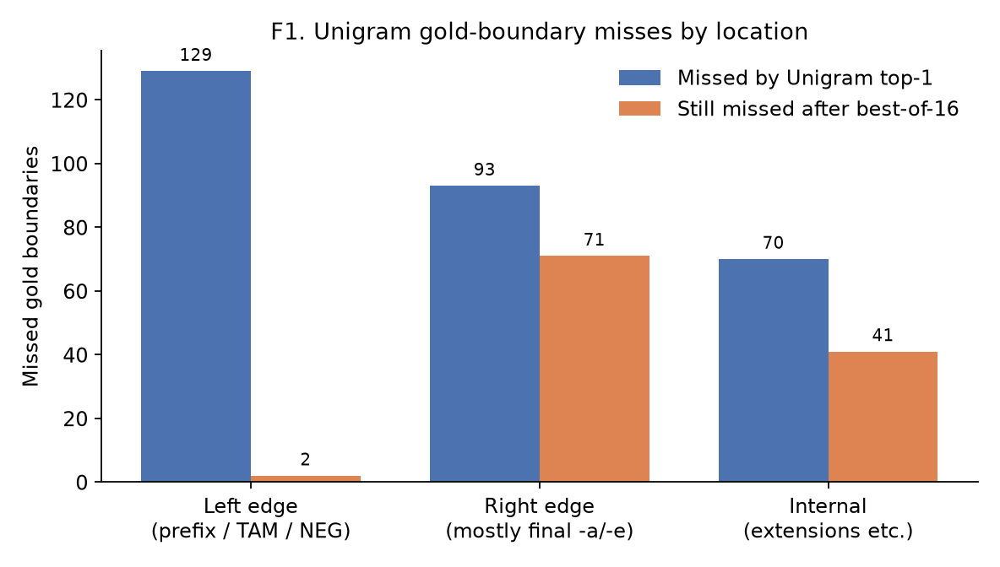
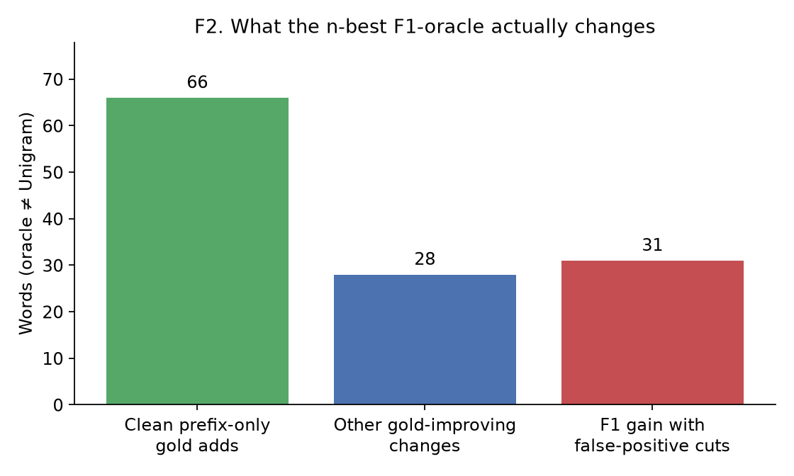
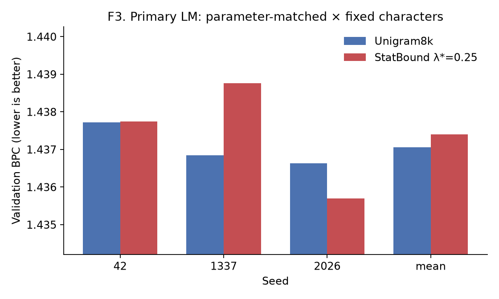

# Paper-facing artifacts v0.1

Generated from frozen Phase C, Phase F, and n-best oracle reports.
No new training. Morphology holdout and LM test were not opened.

## T1. Standard tokenizers on Level-B development

| system | P | R | F1 | exact | TPC |
|---|---:|---:|---:|---:|---:|
| BPE8k | 0.7015 | 0.3764 | 0.4622 | 0.0556 | 0.2285 |
| Unigram8k | 0.8431 | 0.4502 | 0.5551 | 0.0802 | 0.2281 |

Source: `data/reports/phase_c_morphology_v0_2_results.json`. Character is omitted (descriptive only, not a morphology baseline).

## T2. StatBound V1 vs Unigram

| | Unigram8k | StatBound λ*=0.25 |
|---|---:|---:|
| development boundary F1 | 0.5551 | 0.5551 |
| benchmark words changed | 0 | 0 |
| primary validation BPC | 1.437061 ± 0.000582 | 1.437402 ± 0.001559 |
| ΔBPC (SB − Unigram) | — | 0.000341 |
| seeds beating Unigram | — | 1/3 |
| SC4 | — | FAIL |
| SC1 | — | FAIL |

Sources: `data/reports/phase_c_morphology_v0_2_results.json`, `data/reports/phase_f_lm_results_v0_1.json`.

## T3. Unigram n-best=16 F1 oracle

| system | P | R | F1 | exact |
|---|---:|---:|---:|---:|
| Unigram top-1 | 0.8431 | 0.4502 | 0.5551 | 0.0802 |
| Best-of-16 F1 oracle | 0.8315 | 0.8107 | 0.7913 | 0.1358 |

- Oracle ΔF1: **0.2362**
- Exact gold in n-best: **22/162**
- The 0.79 F1 is an analysis ceiling, not a method target.
- Source: `data/reports/unigram_nbest_oracle_v0_1.json`

## F1–F3

- Unigram misses: left 129, right 93, internal 70 (total 292)
- Still missing after oracle: left 2, right 71, internal 41 (total 114)

- Clean prefix: **66**
- Mixed gold: **28**
- Junk FP: **31**
- Unchanged: 37
- Oracle differs on 125; 125 add or keep piece count

Lower BPC is better. Primary condition: parameter-matched × fixed characters.
