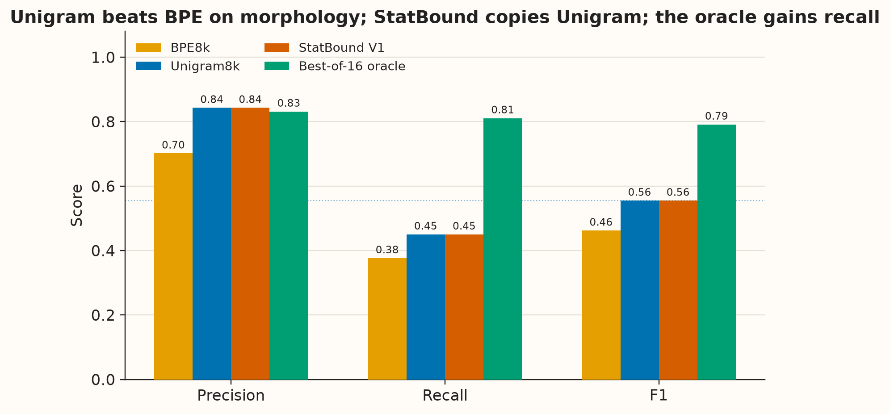
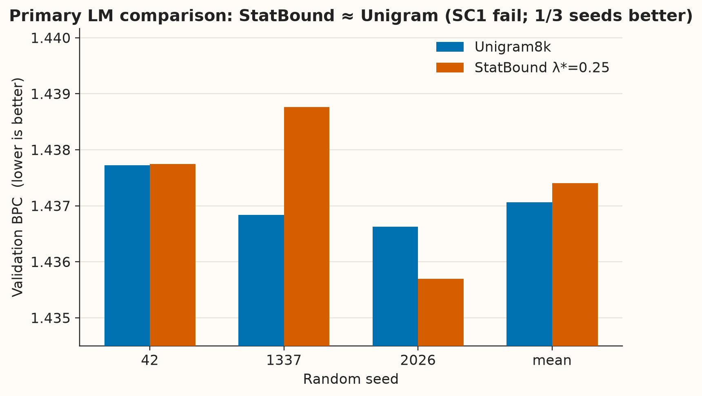
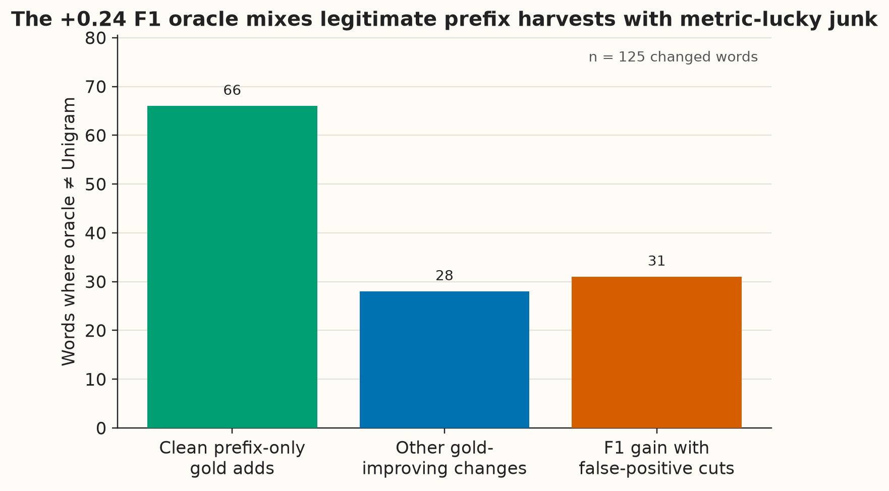
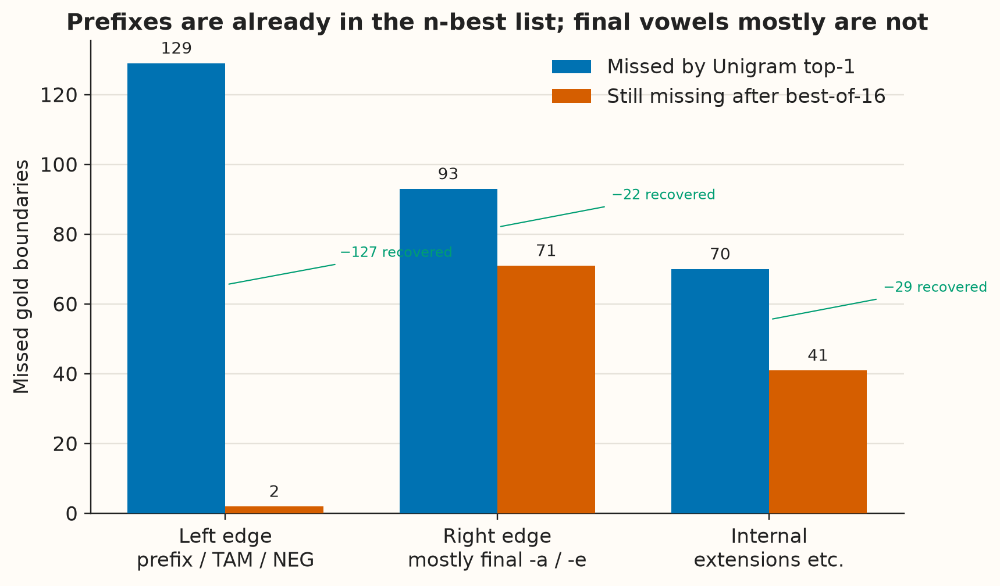
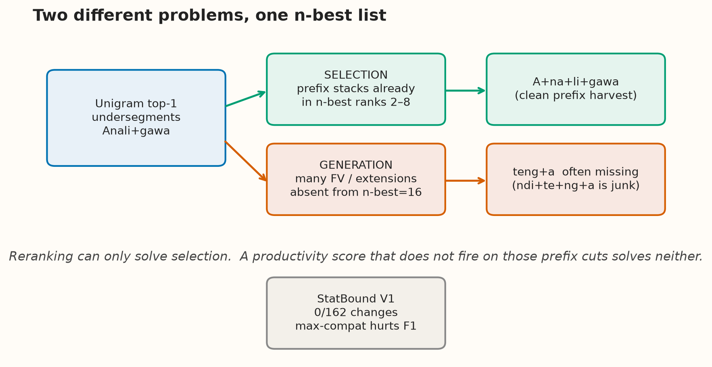
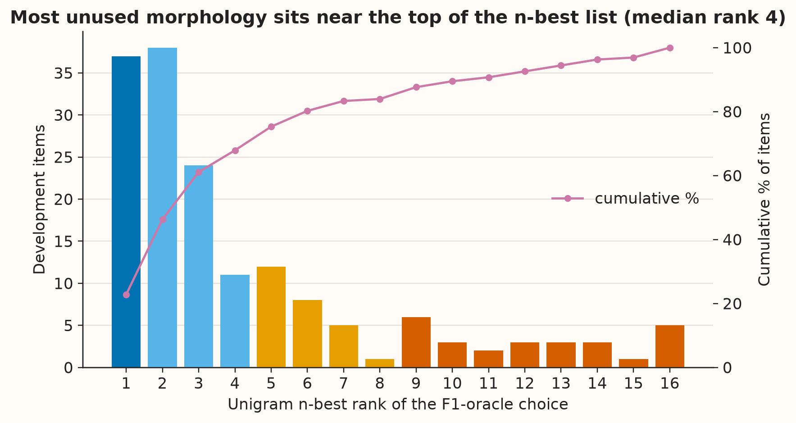
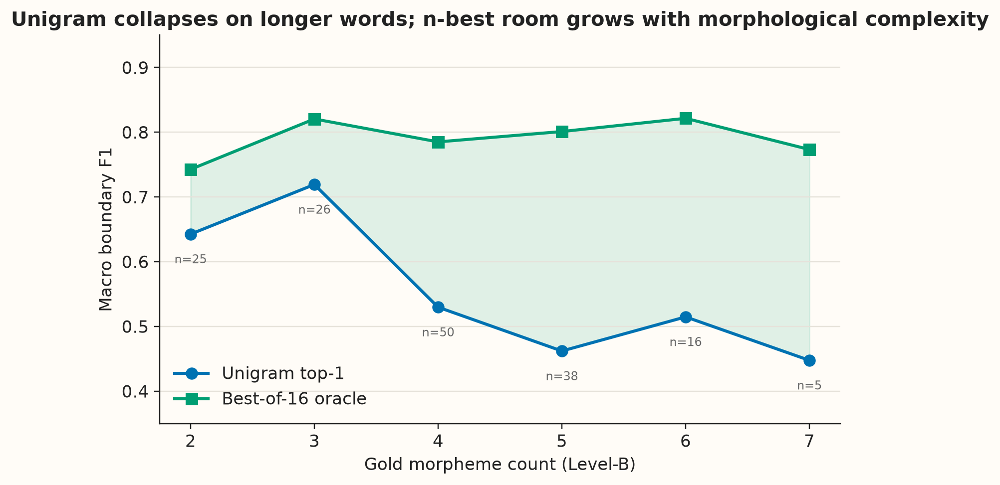
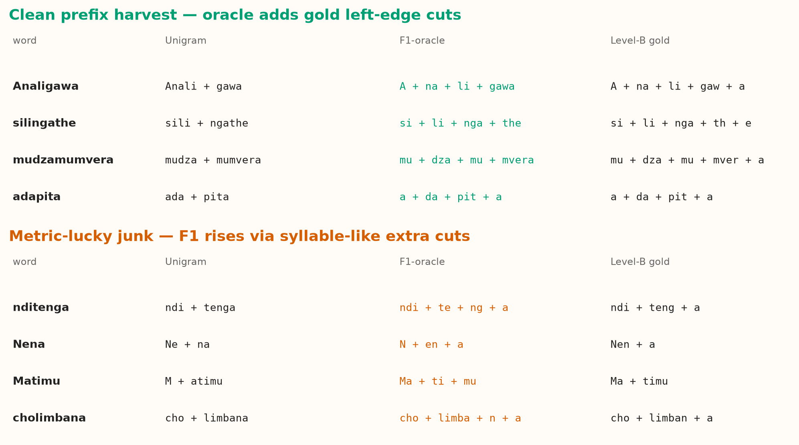
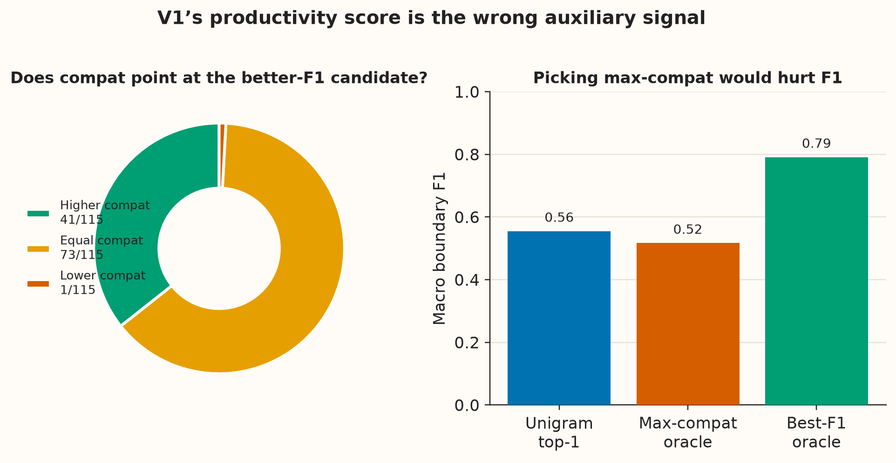

# Unigram Undersegments Chichewa: A Conservative Morphology Benchmark and a Negative Boundary-Reranking Result

**Hyston Kayange**  
AI Research Engineer  

**Working draft — not for citation or submission**  
Mthandizi technical report v0.1 · 18 August 2026  
Morphology holdout locked · LM test locked · StatBound V1 closed

---

## Abstract

Tokenization for agglutinative Bantu languages is often discussed as if a more morphological segmentation would automatically improve both linguistic fidelity and language-model quality. We test that assumption on Chichewa under a frozen corpus, a frozen 8k vocabulary budget, and a pre-registered evaluation protocol. On a conservative native-speaker Level-B development benchmark (162 active items), SentencePiece Unigram-8000 substantially outperforms BPE-8000 on morphological boundary F1 (0.555 vs 0.462), but its error is systematic undersegmentation: precision 0.843 against recall 0.450. An analysis-only oracle over Unigram’s own n-best=16 list raises F1 to 0.791. That unused room is not uniform. Of 292 gold boundaries missed by Unigram top-1, 129 are left-edge inflectional cuts (prefixes, TAM, negation) of which only 2 remain after the oracle; 93 are right-edge cuts, mostly verbal final vowels, of which 71 remain missing. The oracle itself is not a target: among 125 words it changes, 66 are clean prefix harvests and 31 improve F1 via linguistically poor extra cuts. A pre-registered train-only boundary-productivity reranker (StatBound-Unigram V1) changes 0/162 development segmentations, fails the morphology criterion, and fails primary matched language-model BPC (1.4374 vs 1.4371). Its compatibility score does not identify the better-F1 candidates; selecting the maximum-compat candidate *lowers* F1 to 0.517. We conclude that Unigram already contains most missing Chichewa prefix structure in its n-best list, that many final-vowel and internal boundaries are a generation problem rather than a ranking problem, and that morphological boundary F1 and language-model BPC should not be treated as a single objective.

---

## 1. Introduction

Subword tokenization is the usual compromise between a closed vocabulary and an open morphological system. For English-centric byte-pair encoding (BPE; Sennrich et al., 2016) this compromise is often acceptable. For agglutinative Bantu languages it is less obviously so. A Chichewa verb can stack a subject marker, tense–aspect–mood, an object marker, a derivational extension, a final vowel, and a post-final clitic into a single orthographic word. Standard tokenizers are not required to respect those slots, and there is no large public morphological analyzer that we can treat as a free training signal.

Two claims are frequently run together in this setting. The first is **linguistic**: a tokenizer that aligns better with morpheme boundaries is a better tokenizer. The second is **computational**: such a tokenizer will yield a better language model under matched data and compute. The second does not follow from the first. Saleva and Lignos (2021) found no consistent downstream gain from morphology-aware segmentation in low-resource translation. Mager et al. (2022) found that supervised morphological segmentation can *win* intrinsic morph metrics and *lose* translation quality. Any serious study of Bantu tokenization has to keep those two objectives apart.

This paper is a controlled measurement, not a new algorithm. We ask four questions that we actually measured:

1. Under a frozen 8k vocabulary, how do BPE and Unigram compare on conservative Chichewa morphological boundaries?
2. When Unigram misses gold boundaries, *where* are those misses, and how many of each class already exist in Unigram n-best=16?
3. Can a pre-registered, train-only statistical-boundary reranker of that n-best list improve morphology F1 or primary language-model BPC?
4. Do those two quantities move together?

The answers, in brief: Unigram is the stronger standard tokenizer and still undersegments; most missing prefixes are already in the n-best list while many final vowels are not; the reranker is a scientific no-op; and we never obtained a morphological change large enough to test the language-model hypothesis. That last point is a limitation of the intervention, not evidence that morphology cannot matter for BPC.

We do not claim a novel tokenizer, a first Chichewa system, or a language-model win. The contribution is an instrument, a comparison, an n-best anatomy, and a negative result.

---

## 2. Related work

**Unigram versus BPE.** Kudo (2018) introduced the Unigram language-model tokenizer and showed that probabilistic multi-segmentation helps translation, especially in low-resource and out-of-domain conditions. Bostrom and Durrett (2020) argued that Unigram aligns better with morphology than BPE and can improve pretrained language models. Richburg et al. (2020) compared the two on Swahili–English translation: BLEU was similar, but Unigram recovered rare words more faithfully. Those results motivate Unigram as the backbone for a Bantu case study; they do not make Unigram morphologically correct.

**Morphology-aware tokenization.** Several recent systems inject morphological constraints into subword learning. MorphBPE (Asgari et al., 2026) forbids BPE merges that cross gold morpheme boundaries at *training* time. MoVoC (Teklehaymanot et al., 2025) builds hybrid morpheme–BPE vocabularies for Ge’ez-script African languages using supervised analyses. Banerjee and Bhattacharyya (2018) combine Morfessor with BPE. Hudspeth et al. (2026) use rich Latin lexical resources. These methods are relevant and, in several cases, stronger as algorithms than anything we test. They also require supervision or resources we do not have for Chichewa, and they do not replace a measurement of what *standard* Unigram already does.

**Morphology is not generation.** Saleva and Lignos (2021) and Mager et al. (2022) are the closest cautionary results: morphology-aware segmentation is not automatically better for sequence models, and supervised morph scores can anti-correlate with translation quality. MoVoC reports a similar split (intrinsic morph gains, non-significant MT). We treat that literature as a prior over our RQ4.

**Bantu computational morphology.** Meyer and Buys (2022) train a joint subword segmental language model for Nguni languages. That is the strongest Bantu LM-plus-segmentation prior we know, and it is a *different architecture*. Lundin et al. (2026) document an African “token tax”: higher fertility is associated with lower downstream accuracy. Our efficiency criterion (do not inflate tokens-per-character by more than 10%) sits in that conversation.

**Unsupervised boundary discovery.** Harris’s successor variety, Goldsmith’s Linguistica, and the Morfessor family (Creutz and Lagus; Virpioja et al.) induce cuts from type productivity. Our StatBound compatibility score is in that family: prefix/suffix type support and character branching, estimated on train text only. Poon, Cherry and Toutanova (2009) show that unsupervised morphology can be cast as a log-linear model. We do not claim a new induction method. We ask whether a simple member of this family can *rerank* Unigram n-best toward a conservative Chichewa gold standard.

---

## 3. Data and benchmark

### 3.1 Corpus

All tokenizer training and language-model training use the frozen Chichewa corpus v0.1: Bible and Wikipedia text, identity-normalized, with pre-registered train / validation / test splits. Validation is used for language-model BPC and tokenizer efficiency. The test split has never been opened for scientific comparison. Boundary statistics for StatBound were estimated on **train text only**.

### 3.2 Level-B morphology instrument

Intrinsic morphology requires a granularity decision. Fine “syllable-like” gold inflates recall for any oversegmenting tokenizer. Coarse stem-only gold hides the prefixal system that makes Chichewa morphologically interesting. We use a conservative **Level-B** policy, written and frozen before tokenizer evaluation (D-0012):

- Split namable grammatical morphology: subject markers, object markers, TAM, negation, supported extensions, post-finals, productive noun-class prefixes.
- Split a verbal final vowel only when construction and paradigm independently support it (`ndi+teng+a`, not every word-final `a`).
- Keep the safest derived stem when finer decomposition is uncertain (`limban+a`, not a forced `limb+an+a`).
- Never cut on syllable shape alone.

The development set began as 200 annotated records from a single native speaker. After Level-B adjudication, **162** items remain active and **33** are excluded as non-Chichewa or noise. Reconstruction failures in gold: 0. A morphology holdout exists and remains **locked**; no number in this paper is a holdout number.

This is a **single-annotator development instrument**. It is not multi-annotator gold and we do not report human–human agreement as a property of the current rubric. Historical measurements from an earlier, underspecified protocol are archived and not recomputed here.

Gold labels were not used to train Unigram, BPE, or StatBound boundary statistics. They are used to *score* segmentations, and, in Section 6, to *select among already generated Unigram candidates* for an analysis-only oracle.

---

## 4. Experimental setup

### 4.1 Standard tokenizers

We train SentencePiece BPE-8000 and Unigram-8000 on the frozen train split, plus a character tokenizer as an efficiency diagnostic. Vocabulary scale is matched. The character system is **not** treated as a morphology baseline: character boundaries are not a competing morphological analysis.

Morphology metrics are official per-item boundary precision, recall, F1, and exact segmentation match, then macro-averaged over the 162 items (`boundary_metrics` / `aggregate_boundary_metrics`). A boundary is a character offset inside the word. Surface reconstruction is required.

### 4.2 StatBound-Unigram V1

StatBound V1 is a pre-registered inference-time reranker, not a new vocabulary and not a train-time Unigram modification.

For a word \(w\), let \(\mathcal{C}(w)\) be SentencePiece `nbest_encode_as_pieces(w, 16)` union the default Unigram segmentation. Each candidate \(S\) receives

\[
\mathrm{score}(S\mid w)=\sum_{p\in S}\log P(p)+\lambda\cdot\mathrm{compat}(S,w),
\]

where \(\mathrm{compat}\) is a length-normalized signed sum of train-only boundary strengths: productive prefix/suffix type counts and character branching, gated by minimum support and productivity, and scored only near word edges (maximum affix context 6). The frozen \(\lambda\) grid is \(\{0, 0.25, 0.5, 1.0, 2.0\}\). \(\lambda=0\) must reproduce ordinary Unigram. Selection among nonzero \(\lambda\) used validation tokens-per-character eligibility then development F1, then lower TPC, then smaller \(\lambda\). Language-model BPC was forbidden in that choice. All nonzero \(\lambda\) produced identical development F1; the tie-break selected \(\lambda^*=0.25\).

### 4.3 Language-model protocol

Primary comparison (SC1): parameter-matched decoder LM, fixed-character budget, three seeds (42, 1337, 2026), validation bits-per-character. Pass requires a strictly lower mean BPC than Unigram-8000 and improvement on at least two of three seeds. Architecture-matched and fixed-update regimes are secondary or diagnostic. Source-wise Bible/Wikipedia BPC is reported as a robustness check, not as a substitute primary gate.

### 4.4 Analysis-only n-best oracle

Independently of StatBound, we score every Unigram n-best candidate against Level-B gold and, for each word, select the candidate with highest item F1 (ties prefer the Unigram default). This uses gold as a **scoring function over a frozen candidate set**. It does not train a tokenizer, choose \(\lambda\), or update boundary statistics. We also report a *compat-oracle* that instead selects \(\arg\max \mathrm{compat}\), to test whether V1’s auxiliary score points at the F1-better candidates.

---

## 5. Results

### 5.1 Unigram outperforms BPE and still undersegments

**Table 1.** Level-B development morphology (162 items). TPC is tokens per character on the frozen validation text.

| System | P | R | F1 | Exact | TPC |
|--------|--:|--:|---:|------:|----:|
| BPE-8000 | 0.7015 | 0.3764 | 0.4622 | 0.0556 | 0.2285 |
| Unigram-8000 | 0.8431 | 0.4502 | **0.5551** | 0.0802 | 0.2281 |
| StatBound \(\lambda^*=0.25\) | 0.8431 | 0.4502 | 0.5551 | 0.0802 | 0.2281 |

Unigram is the strongest standard tokenizer on this instrument, consistent with Bostrom and Durrett (2020) and with Richburg et al. (2020) on Swahili. The win is not “Unigram is morphological.” Precision is high; recall is not. Unigram’s typical error is to keep prefix stacks and stems glued together, not to invent spurious cuts. BPE is worse on both precision and recall.

Bible items (\(n=120\)) show even more extreme undersegmentation (Unigram P 0.882, R 0.406). Wikipedia items (\(n=42\)) are closer to balanced (P 0.737, R 0.579). We treat that split as descriptive: the sample is Bible-heavy.



**Figure 1.** Macro precision, recall, and F1 on the frozen 162-item development set. StatBound is visually identical to Unigram. The analysis-only n-best oracle improves F1 almost entirely by raising recall.

### 5.2 StatBound V1 is a scientific no-op

Every frozen \(\lambda \in \{0.25, 0.5, 1.0, 2.0\}\) produced the same 162 segmentations as Unigram. The failure diagnostic is mechanical: across 2,376 non-top-1 candidates, \(\lambda \times \Delta\mathrm{compat}\) never exceeded the Unigram score gap. Typical Unigram gaps are about 13 nats; compatibility lives in roughly \([-1, 1]\). The nearest any alternative came to flipping was \(-0.058\), and that ceiling did not move as \(\lambda\) increased. Near-tie Unigram competitors are boundary-tied with top-1; candidates with a real compatibility advantage sit far down the list.

**Table 2.** Primary language-model comparison (parameter-matched × fixed characters).

| | Unigram-8000 | StatBound \(\lambda^*=0.25\) |
|--|-------------:|----------------------------:|
| Mean validation BPC | 1.437061 ± 0.000582 | 1.437402 ± 0.001559 |
| \(\Delta\)BPC (SB − Unigram) | — | \(+0.000341\) |
| Seeds better than Unigram | — | 1 / 3 |
| SC1 | — | **Fail** |
| SC4 development morphology | — | **Fail** |



**Figure 2.** Seed-level primary BPC. Lower is better. Only seed 2026 favors StatBound. Because StatBound did not change any development-word segmentation, this panel does not test a morphologically different tokenizer; it tests a near-copy of Unigram.

Secondary architecture-matched BPC is slightly better for StatBound (\(\Delta -0.0005\)) and is not a substitute primary result. Tokens-per-character is essentially unchanged. Bible BPC is slightly worse, Wikipedia slightly better; neither approaches a 0.02 robustness failure. Those secondary passes do not rehabilitate a no-op method.

---

## 6. N-best and error anatomy

The interesting measurement is not that StatBound failed. It is *what Unigram already had available*.

### 6.1 A large unused ceiling, with a warning

**Table 3.** Analysis-only Unigram n-best=16 F1 oracle.

| System | P | R | F1 | Exact |
|--------|--:|--:|---:|------:|
| Unigram top-1 | 0.8431 | 0.4502 | 0.5551 | 13 / 162 |
| Best-of-16 F1 oracle | 0.8315 | 0.8107 | 0.7913 | 22 / 162 |

The oracle gains **+0.236 F1**, almost entirely recall (\(+0.361\)) at a small precision cost (\(-0.012\)). Exact gold is in the n-best set for only 22 items (13.6%). So the metric can move a great deal without exact morphological analysis.

That 0.79 number is **not a method target**. Gold is choosing among Unigram’s own candidates. Some of those candidates are linguistically bad and still raise item F1 because they happen to hit a gold offset.



**Figure 3.** Among 125 words where the F1-oracle differs from Unigram: 66 add only gold left-edge cuts; 28 make other gold-improving changes; 31 raise F1 while introducing at least one false-positive cut. 124 of 125 changes only add splits.

### 6.2 Prefixes are a selection problem; final vowels are a generation problem

Unigram misses 292 gold boundaries and introduces only 64 extra cuts. Those 292 misses are not one phenomenon.

**Table 4.** Gold boundaries missed by Unigram, and those still missed after the F1-oracle.

| Zone | Unigram misses | Still missing after best-of-16 |
|------|---------------:|-------------------------------:|
| Left edge (prefix / TAM / NEG) | 129 | **2** |
| Right edge (mostly final `-a` / `-e`) | 93 | **71** |
| Internal (extensions and other) | 70 | 41 |
| Total | 292 | 114 |



**Figure 4.** Left-edge gold cuts are almost entirely present in n-best=16. Right-edge gold cuts, dominated by verbal final vowels under Level-B Rule 1, are mostly absent. Reranking cannot invent a cut that no candidate contains.

This is the central anatomical result. Recovering `A+na+li` from `Anali`, or `si+li+nga` from `sili`, is a **selection** problem: Unigram already ranks those paths. Recovering `teng+a` from `tenga` is, for this generator, mostly a **generation** problem: the n-best list keeps the final vowel attached to the stem. Of 71 remaining right-edge misses after the oracle, 59 are gold `+a` and 12 are gold `+e`.



**Figure 5.** Schematic of the two problems. A reranker can only act on the upper path. StatBound’s productivity score does not fire on the disputed prefix cuts (all 112 disputed offsets among the 73 zero-\(\Delta\)compat items have strength 0).

### 6.3 Where in the n-best list the unused morphology sits



**Figure 6.** Unigram rank of the F1-oracle winner. Rank 1 is already optimal for 37 items. Rank \(\le 2\) captures a large additional mass; the median rank among changed items is 4. Deep ranks still contain some gold, but most of the unused morphology is nearby.

If one may only use ranks \(\le 2\), oracle F1 is already 0.663 (\(+0.108\)). Ranks \(\le 4\) reach 0.737 (\(+0.182\)). The full 16-best list reaches 0.791. Shallow lists therefore contain most of the *available* gain—and still do not contain most final vowels.

### 6.4 Longer words are where Unigram collapses



**Figure 7.** Macro F1 as a function of Level-B gold piece count. Unigram is strongest on two- and three-piece words and falls on four-to-seven-piece words, exactly the prefix-stacking verbs. The oracle gap widens there. Sample sizes are annotated; the two monomorphemic items have undefined official F1.

### 6.5 Some high-F1 n-best paths are linguistically poor



**Figure 8.** Top: oracle adds gold prefixes and often still misses the final vowel (`Analigawa`, `silingathe`). `adapita` is an exact gold hit. Bottom: item F1 rises because a syllable-like cut happens to land on a gold offset (`ndi+te+ng+a` vs gold `ndi+teng+a`). An honest method must not chase the second class.

This is why we refuse to treat the oracle as a training target or as proof that “Unigram contains Chichewa morphology.” It contains **many prefix alternatives**. It contains **some** lucky final-vowel hits entangled with stem-internal junk. It does not contain a full Level-B analysis.

### 6.6 V1’s compatibility score points the wrong way

Among 115 items with a strictly higher-F1 neighbour:

- higher `compat`: **41**
- equal `compat`: **73** (every disputed boundary has V1 strength 0)
- lower `compat`: **1**

Pooled Spearman(\(\mathrm{compat}\), item F1) over 2,512 defined candidate pairs is \(-0.015\). Mean within-item Spearman is \(-0.035\).



**Figure 9.** Left: the F1-better neighbour is usually *not* preferred by `compat`. Right: an oracle that maximises `compat` scores **0.517 F1**, worse than ordinary Unigram (0.555). Calibration of \(u+\lambda b\) cannot repair a signal that, used perfectly, would hurt the metric.

That is the reason StatBound is closed rather than retuned. A larger \(\lambda\), a temperature, or a candidate-relative residual on the *same* \(b\) is the same wrong expert.

---

## 7. Discussion

**Unigram is the right standard baseline, not a morphological analyzer.** On this conservative instrument it is clearly better than BPE. That finding is useful, expected from prior work, and easy to over-read. High precision and low recall mean Unigram is a cautious undersegmenter of Chichewa verbs. It is not emitting Level-B analyses.

**Availability and selection must be separated.** The n-best list already contains almost every gold left-edge inflectional cut. If the scientific goal is prefix-stack recovery, the missing object is a *selector* that prefers those candidates without promoting the 31 junk paths. If the scientific goal is full Level-B segmentation, including Rule 1 final vowels, the missing object is a *generator*: n-best=16 does not contain the cuts.

**The first auxiliary score was the wrong construct.** Harris-style edge productivity answers “where do types branch?” Level-B answers “which cuts are namable Chichewa morphs under a conservative rubric?” Those questions overlap less than the original method assumed. The 73 zero-\(\Delta\)compat items are the proof: the statistic is silent exactly where the unused gold prefixes sit.

**Morphology F1 and BPC were never jointly tested.** Phase F compared two tokenizers that agreed on all 162 benchmark words. Secondary BPC wobbles of a few ten-thousandths of a bit are not a morphology-aware language-modeling result. The honest implication for RQ4 is weaker and more important: we should stop writing success criteria as if a single method must win both. Literature already warned us. This experiment illustrates the warning from the other direction—an intervention that failed to change morphology also failed to change BPC, which is consistent with a no-op, not with a deep coupling.

**What we are not concluding.** We are not concluding that morphology-aware tokenization is hopeless for Chichewa, that Unigram n-best is an adequate morphological generator, or that a prefix-only follow-up would improve language models. Those are later questions. They are not required to make the present measurements publishable as an empirical report.

---

## 8. Limitations

- **Single annotator, \(N=162\).** Level-B is a documented conservative rubric, not inter-annotator truth. Bible items dominate.
- **Development-only morphology.** The holdout is locked. Every F1 in this paper is a development number and must be labeled as such.
- **Oracle contamination of interpretation, not of training.** We used gold to *understand* the n-best list after V1 failed. We did not use those choices to set \(\lambda\) or to train a reranker. Readers should still treat the anatomy as post-hoc analysis of a frozen system.
- **Zone heuristics.** “Left edge” means offset \(\le 4\); “right edge” means at most two remaining characters. Those cutoffs match prefixal and final-vowel structure in this sample; they are not a linguistic theory.
- **Small language model.** The LM is a matched from-scratch decoder on a modest corpus. Results do not speak to large multilingual pretrained models.
- **Whitespace path.** A minor StatBound encode-path inconsistency (`split()` vs full-line) explains tiny TPC wobble and is not a morphology result.
- **No claim about other unsupervised morph tools.** We did not evaluate Morfessor as a selector. That remains future work, not a hidden negative.

---

## 9. Conclusion

Unigram-8000 is a stronger match than BPE-8000 to a conservative native-speaker morphology benchmark for Chichewa, and it is still an undersegmenter. Its n-best search space already contains most of the missing inflectional prefix structure and little of the missing final-vowel structure. A pre-registered unsupervised productivity reranker neither selects the unused prefixes nor improves primary language-model BPC, and the auxiliary score it used would lower F1 even if it were maximized. Morphological fidelity and LM tokenization efficiency should be stated as separate objectives. The next method, if any, is a later, separately registered question about prefix-stack *selection*—not a retuning of the method we closed.

---

## Acknowledgments

The Level-B development benchmark was annotated and adjudicated by a native speaker of Chichewa. Morphology holdout and LM test remain unused.

---

## References

Asgari, E., et al. (2026). MorphBPE. *Findings of ACL*.

Banerjee, T., & Bhattacharyya, P. (2018). Meaningless yet meaningful: Morphology grounded subword-level NMT. *SCLeM*.

Bostrom, K., & Durrett, G. (2020). Byte pair encoding is suboptimal for language model pretraining. *Findings of EMNLP*.

Creutz, M., & Lagus, K. Unsupervised models of morpheme segmentation and morphology learning. *Morfessor*.

Goldsmith, J. (2001). Unsupervised learning of the morphology of a natural language. *Computational Linguistics*.

Harris, Z. S. (1955). From phoneme to morpheme. *Language*.

Hudspeth, W., Burns, P. J., & O’Connor, B. (2026). Morphologically-guided tokenization for Latin. *EACL*.

Kudo, T. (2018). Subword regularization: Improving neural network translation models with multiple subword candidates. *ACL*.

Lundin et al. (2026). The token tax. *AfricaNLP*.

Mager, M., et al. (2022). BPE vs. morphological segmentation: A case study on machine translation of four polysynthetic languages. *Findings of ACL*.

Meyer, F., & Buys, J. (2022). Subword segmental language modelling for Nguni languages. *Findings of EMNLP*.

Poon, H., Cherry, C., & Toutanova, K. (2009). Unsupervised morphological segmentation with log-linear models. *NAACL*.

Richburg, A., Eskander, R., Muresan, S., & Carpuat, M. (2020). An evaluation of subword segmentation strategies for neural machine translation of morphologically rich languages. *WiNLP*.

Saleva, J., & Lignos, C. (2021). The effectiveness of morphology-aware segmentation in low-resource neural machine translation. *EACL SRW*.

Sennrich, R., Haddow, B., & Birch, A. (2016). Neural machine translation of rare words with subword units. *ACL*.

Teklehaymanot et al. (2025). MoVoC. *Findings of EMNLP*.

Virpioja, S., et al. Morfessor 2.0.

---

## Reproducibility note

Figures in this draft are generated from frozen Phase C, Phase F, and n-best oracle artifacts:

```bash
.venv/bin/python scripts/tokenizers/render_paper_figures_v0_1.py
```

No holdout, LM-test, or new training run is required to rebuild them. Decision log: D-0008–D-0016.
