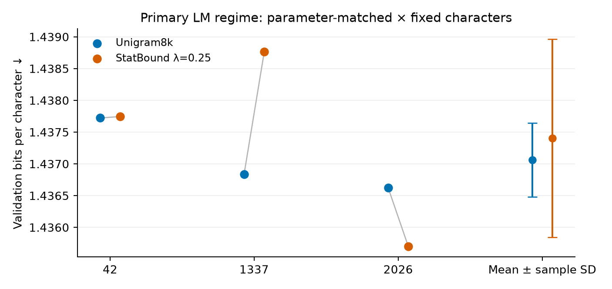
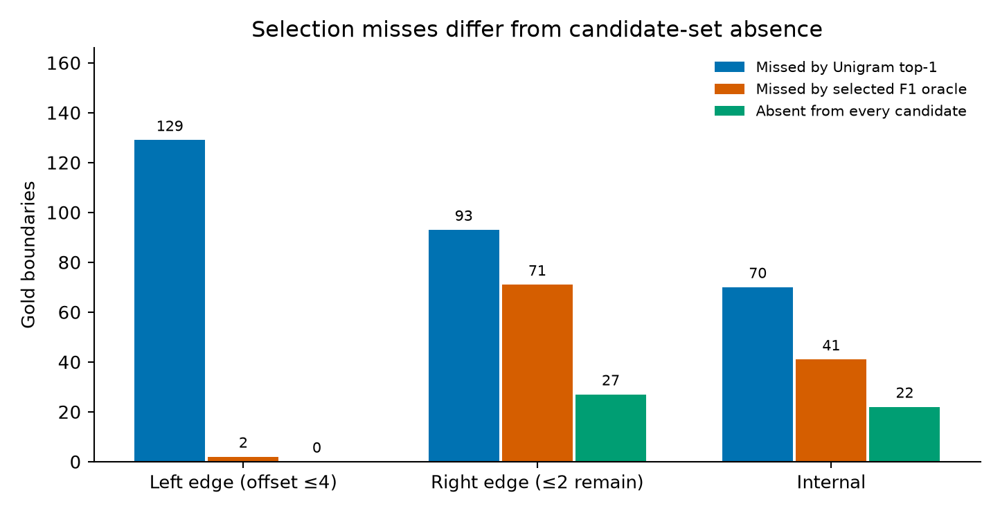
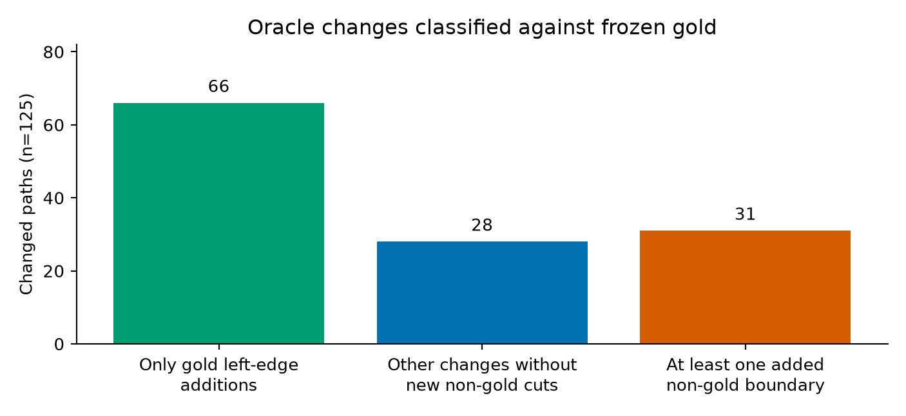

# Unigram Undersegments Chichewa: A Conservative Morphology Benchmark and a Negative Boundary-Reranking Result

Hyston Kayange

Working draft v0.2 · 10 November 2026 · Author review required before submission

## Abstract

We compare tokenization against a Chichewa development benchmark combining native-speaker labels, frozen policy revisions, and adjudication of 11 flagged cases, and report a preregistered negative reranking experiment. Under the frozen scoring implementation, Unigram-8000 has higher macro boundary F1 than BPE-8000 (0.5551 versus 0.4622), while pooled counts show substantial undersegmentation. A gold-selected oracle over stored Unigram n-best candidates reaches 0.7913 macro F1. Crucially, missing boundaries in that selected path are not the same as boundaries absent from every candidate. All 129 gold left-edge boundaries missed by Unigram occur somewhere in the candidate list; 27 of 93 missed right-edge boundaries and 22 of 70 internal boundaries are absent from its union. Availability does not establish joint recoverability or identify a usable selector. A train-only boundary-productivity reranker, StatBound V1, changes none of the 162 development segmentations at the registered weights. It fails the primary parameter-matched language-model criterion: mean validation BPC is 1.437402 versus 1.437061 for Unigram, with one of three seeds improving. We document conditional macro denominators, empty-piece warnings in the frozen scorer, a small single-annotator sample, and the limits of previously public test artifacts. The evidence supports a development-set comparison and a negative intervention result; it does not establish that improving morphology would improve language modelling.

## 1. Introduction

Chichewa orthographic words can contain several grammatical elements, making tokenizer boundaries an informative but incomplete proxy for morphological structure. The lexical and grammatical distinctions relevant to annotation require an explicit granularity policy; the frozen Level-B instrument preserves opaque stems while splitting supported grammatical morphology. Its background is Chichewa grammatical scholarship, including Mchombo (2004), rather than syllable shape.

Subword algorithms optimize objectives that need not coincide with this instrument. BPE supplies a standard vocabulary-building baseline (Sennrich et al., 2016), whereas Unigram assigns scores to alternative piece sequences (Kudo, 2018). We ask: which aligns better with the frozen development annotations; which missing offsets occur in Unigram's candidate set; and whether the registered StatBound intervention improves morphology or primary LM validation BPC.

This report consolidates finished experiments. It contributes a documented annotation instrument, a controlled comparison, an analysis of candidate availability versus selection, and a negative reranking result. No successor tokenizer or new evaluation is introduced in this revision.

## 2. Related work

Bostrom and Durrett (2020) report closer morphological alignment for Unigram than BPE in their pretraining setting. Richburg et al. (2020) compare Swahili and Turkish translation into English, finding comparable BLEU and better rare-word recall with Unigram. These studies motivate the comparison without establishing its outcome for Chichewa. The implementations here use SentencePiece (Kudo and Richardson, 2018).

Morphological alignment also need not predict downstream gains. Saleva and Lignos (2021) find no consistent translation advantage across their segmentation comparisons. Mager et al. (2022) report that stronger supervised segmentation scores can coexist with worse translation results. MoVoC integrates supervised morphological analysis into subword construction for Ge'ez-script languages and reports intrinsic improvements without significant automatic translation gains (Teklehaymanot et al., 2025).

Other approaches change the intervention itself. MorphBPE constrains merges during tokenizer training (Asgari et al., 2026); Hudspeth et al. (2026) study contextual morphology-guided tokenization for Latin encoders. Meyer and Buys (2022) jointly learn segmentation and language modelling for four Nguni languages. Poon et al. (2009) study unsupervised morphological segmentation with log-linear models. These are related approaches, not direct experimental comparators here. Our narrow question concerns a frozen inference-time score over an existing Unigram candidate set; no methodological novelty is claimed for log-linear reranking.

## 3. Corpus and annotation instrument

The frozen corpus contains Bible and Wikipedia text. Tokenizers, LM training, and boundary statistics use the training partition; LM BPC and tokenization efficiency use validation. Scientific comparisons in this report use development morphology and LM validation only. Source attribution, extraction changes, corpus hashes, and acquisition limitations are documented in the repository.

The annotation flow is **200 canonical records → five previously excluded → 195 Level-B source items → 33 further exclusions → 162 active items**. The final set contains 120 Bible and 42 Wikipedia items. It was selected for diagnostic morphology review, not as a random population sample; automatic candidate strata included tokenizer disagreement and apparent morphological complexity. Its scores do not estimate accuracy on arbitrary running Chichewa text.

One native Chichewa-speaking annotator supplied the original labels. Computational linguistic assistance supported research and proposal generation; it was not a second independent human annotator. The 195-item application retained 18 original analyses, accepted 133 policy revisions, referred 11 cases to native-speaker adjudication, and excluded 33 under the frozen scope/source-quality criteria. All 11 referrals were resolved. The explicit final native-speaker decisions cover those 11 exceptions; the record does not establish an independent native-speaker reannotation of all 133 policy revisions. Final gold has zero surface-reconstruction failures.

Level B splits independently supported subject/agreement, NEG, TAM, object, noun-class, extension, final-vowel, and post-final morphology. Final vowels are construction-dependent, and opaque derived stems remain intact. For example, the confirmed `ndi+sana+nen+e` preserves the grammatical `sana` unit; ambiguous locative and lexical cases follow recorded human decisions. This revision changes no label or policy. The active file's SHA-256 remains `73b948d782b6e979814de051ffad315ca282cbff5fc7f8c5de15b0c864852f67`.

Historical exact self-agreement 0.52 and boundary F1 0.841 describe the original underspecified protocol. They are not recomputed, human–human agreement, or validation of the later Level-B rubric.

## 4. Frozen methods and scoring qualifications

### 4.1 Tokenizers and morphology metrics

The standard systems are SentencePiece BPE-8000 and Unigram-8000 trained on the same frozen training text. A character tokenizer is an efficiency diagnostic, not a competing linguistic analysis. The registered morphology implementation computes piece-boundary precision, recall, F1, and exact piece-list match, then averages each metric over items where that metric is defined.

This detail matters. Stored Unigram item values have defined precision for 152 items, recall for 160, and F1 for 150. The F1-oracle has corresponding counts 162, 160, and 160. Exact match uses all 162. The reported macro F1 values are therefore conditional averages with different supports; 0.7913 − 0.5551 is not a paired mean over identical items. The stored oracle report separately gives paired mean ΔF1 0.238858 over 150 defined comparisons. Its pooled micro F1 is 0.7853 versus 0.5253 for Unigram, using all stored boundary counts.

The frozen Phase-C integrity record also reports one BPE and three Unigram empty-piece warnings after stripping SentencePiece's word-start marker. All predicted surfaces reconstruct, but empty pieces are retained by the historical scorer and can introduce endpoint offsets. This revision discloses those warnings and preserves the registered values. A strict internal-boundary implementation would require a separately versioned protocol; it is not silently substituted here.

### 4.2 StatBound and weight selection

StatBound V1 reranks up to 16 Unigram candidates, with the default segmentation included, using `Unigram score + λ × boundary compatibility`. Compatibility is estimated from train-only edge-support/productivity statistics. The registered grid is 0, 0.25, 0.5, 1.0, and 2.0; zero is a control, not an eligible method weight. The zero control matches Unigram boundaries on all 162 development items.

Eligible nonzero candidates must have validation tokens-per-character (TPC) at most 1.10 times Unigram's. Selection maximizes development boundary F1, then minimizes TPC, then λ. LM BPC is not a selection input. All nonzero candidates have identical development F1; λ*=0.25 is the frozen selection. Neither the method nor its weights are changed in this report.

### 4.3 LM comparison and post-hoc oracle

The primary LM regime is parameter-matched × fixed-character budget, with seeds 42, 1337, and 2026. SC1 requires a lower mean validation BPC and improvement for at least two paired seeds. Architecture-matched fixed-character results are secondary; fixed-update regimes are diagnostic. Three seeds provide limited precision, and passing or failing the registered gate is not a statistical equivalence test.

The oracle uses gold to select a stored candidate after the V1 evaluation. It ranks defined item F1, handles exact matches explicitly, and resolves remaining ties by Unigram rank, score, piece count, and lexical order. Default Unigram wins tied Unigram scores when ranks are assigned. This is post-hoc analysis, not a deployable tokenizer or a training target.

## 5. Frozen results

**Table 1.** Logged development macro metrics and validation TPC. Exact is piece-list accuracy over 162 items. Conditional macro denominators and normalization warnings are described in Section 4.1; no scoring convention has been changed.

| System | Precision | Recall | F1 | Exact | TPC |
|---|---:|---:|---:|---:|---:|
| BPE-8000 | 0.7015 | 0.3764 | 0.4622 | 0.0556 | 0.2285 |
| Unigram-8000 | 0.8431 | 0.4502 | 0.5551 | 0.0802 | 0.2281 |
| StatBound λ=0.25 | 0.8431 | 0.4502 | 0.5551 | 0.0802 | 0.2281 |

Unigram has the higher logged morphology F1, while pooled counts still show undersegmentation: 292 missed gold boundaries against 64 non-gold predicted cuts. All four nonzero StatBound weights leave the 162 selected development segmentations unchanged, so SC4 fails. In the frozen failure diagnostic, weighted compatibility differences do not overcome the Unigram score gaps. A separate maximum-compatibility selection has macro F1 0.5169, below Unigram. This shows poor alignment of that score with this instrument; it does not prove that every possible mixed weighting would fail.

**Table 2.** Primary LM validation, parameter-matched × fixed-character budget. Differences are StatBound minus Unigram; standard deviations are sample SD across seeds.

| Seed/statistic | Unigram BPC | StatBound BPC | ΔBPC |
|---|---:|---:|---:|
| 42 | 1.437722 | 1.437744 | +0.000022 |
| 1337 | 1.436837 | 1.438762 | +0.001926 |
| 2026 | 1.436625 | 1.435700 | −0.000924 |
| Mean | 1.437061 | 1.437402 | +0.000341 |
| Sample SD | 0.000582 | 0.001559 | — |

SC1 fails: the mean is higher, and only one seed improves. SC2 passes its secondary criterion (mean ΔBPC −0.000536). Parameter-matched and architecture-matched fixed-update mean differences are +0.000598 and −0.000007 respectively; these remain diagnostic. SC5 passes at TPC 0.2280992074 versus Unigram's 0.2281023595. The tiny difference includes a recorded whitespace encoding-path inconsistency and is not evidence of a linguistic efficiency gain. SC6 passes: primary Bible and Wikipedia mean BPC differences are +0.001311 and −0.002176, both below the +0.02 regression limit.

StatBound V1 entered LM evaluation despite failing SC4 because the pre-registered protocol evaluates the selected λ* on the remaining independent criteria; Phase-C morphology failure was not used to modify the method.

**Figure 1.** Paired seed BPC and mean ± sample SD under the primary regime. Lower is better. The experiment does not establish the LM effect of a successful morphology intervention: StatBound changed none of the development segmentations, although broader-text encoding is not completely identical.

## 6. Candidate availability and oracle selection

The stored F1-oracle has macro precision 0.8315, recall 0.8107, F1 0.7913, and exact match 22/162. Exact gold occurs somewhere in the candidate list for those 22 items, including 13 already exact under Unigram. Of 125 changed paths, 115 strictly improve defined baseline F1; ten have undefined baseline F1 and cannot be described as measured F1 gains. These counts are not interchangeable.

**Table 3.** Gold offsets by the existing positional bins. “Absent” means absent from the union of every stored candidate. It does not mean absent from just the selected F1 path.

| Positional bin | Missed by top-1 | Missed by selected oracle | Absent from every candidate |
|---|---:|---:|---:|
| Left edge: offset ≤4 | 129 | 2 | 0 |
| Right edge: ≤2 characters remain | 93 | 71 | 27 |
| Internal | 70 | 41 | 22 |
| Total | 292 | 114 | 49 |

Left-edge classification takes precedence where bins overlap. These are coordinate heuristics, not independently annotated grammatical categories. The right-edge region often contains final vowels under Level B, but position alone does not identify a morpheme.

**Figure 2.** The candidate union contains all 129 missed left-edge offsets and 66 of the 93 missed right-edge offsets. The selected oracle recovers only 22 of the latter. Thus 71 remaining right-edge misses cannot be interpreted as 71 unavailable boundaries. Union availability is also insufficient to prove that all desired cuts coexist in one candidate or can be selected without extra cuts.

Among changed paths, 66 add only gold left-edge offsets without removing boundaries or adding non-gold ones; 28 make other changes without new non-gold cuts; 31 introduce at least one non-gold cut. In 124 cases, boundaries are only added; the remaining change also removes a boundary. These are mechanical comparisons against the frozen rubric, not 125 new native-speaker judgments about linguistic acceptability.

**Figure 3.** Counts of changed paths by added-boundary behavior. A higher boundary F1 can coexist with an unsupported additional cut; consequently, the oracle is not an appropriate pseudo-gold training target.

Compatibility is higher for the recorded better-F1 alternative in 41/115 items, equal in 73, and lower in one. All 112 disputed offsets in the equal-compatibility group have zero recorded V1 strength. This supports closing the particular V1 intervention. It does not establish that weighting alone explains the broader selection problem, or that morphology-oriented reranking in general cannot work.

## 7. Limitations and publication provenance

The instrument has one native annotator, 162 selected development items, and a Bible-heavy domain mix. It has no independent human–human agreement estimate. Neither diagnostic selection nor positional bins support population-wide linguistic claims. The reported morphology comparison is development evidence, not a confirmatory holdout result.

Conditional macro denominators, exact-match treatment, and empty-piece warnings limit interpretation of the logged morphology scores. This report preserves them rather than correcting outcomes after evaluation. Small LM budgets and three seeds limit generalization; primary failure is evidence about the registered experiment, not proof of zero population effect. Since the morphology intervention did not change benchmark predictions, the relation between a successful morphology intervention and LM quality remains untested.

Protected LM-test artifacts and a sealed morphology package were previously included in public Git history. An owner-approved rewrite removed eight paths from published history on 10 November 2026. Existing clones or caches may retain copies, and the underlying source texts are public. “Locked” describes a procedural evaluation restriction, not a claim of historical confidentiality. No holdout or LM-test result is used here, and this revision does not open either set. Any later confirmatory study must account for the exposure history rather than assume the cleanup restored an unseen test set.

Raw source archives are not retained; an immutable Wikipedia dump identifier and its archive hash cannot be recovered from the current provenance. Rebuilding presentation artifacts from frozen JSON is reproducible; reproducing the original source acquisition is a more limited claim. Source text, original code, annotations, model artifacts, and the paper have separate licensing considerations.

## 8. Conclusion

Under its frozen scorer, Unigram has higher Chichewa development morphology F1 than BPE but misses many gold boundaries. Stored alternatives contain all missed left-edge offsets and many, though not all, missed right-edge and internal offsets. Candidate availability and joint path selection must be distinguished. StatBound V1 neither changes benchmark predictions at its registered weights nor passes the primary LM gate. The result motivates careful separation of the annotation instrument, candidate generation, candidate selection, and downstream objectives, while leaving any successor experiment to a separate preregistration.

## Acknowledgments and assistance

The original development annotations and the 11 final human exceptions were supplied by a native Chichewa-speaking annotator. Computational assistants supported linguistic research, proposal generation, coding, and editorial checks; they are not counted as independent human annotators. The author is responsible for the scientific claims and should approve this working draft before submission.

## References

Asgari, Ehsaneddin, Yassine El Kheir, MohammadAli SadraeiJavaheri, and Ali Nazari. 2026. [MorphBPE: Morphology-Aware Tokenization for Efficient LLM Training](https://aclanthology.org/2026.findings-acl.2068/). Findings of ACL.

Bostrom, Kaj, and Greg Durrett. 2020. [Byte Pair Encoding is Suboptimal for Language Model Pretraining](https://aclanthology.org/2020.findings-emnlp.414/). Findings of EMNLP.

Hudspeth, Marisa, Patrick J. Burns, and Brendan O'Connor. 2026. [Contextual morphologically-guided tokenization for Latin encoder models](https://aclanthology.org/2026.eacl-long.270/). EACL.

Kudo, Taku. 2018. [Subword Regularization: Improving Neural Network Translation Models with Multiple Subword Candidates](https://aclanthology.org/P18-1007/). ACL.

Kudo, Taku, and John Richardson. 2018. [SentencePiece: A simple and language independent subword tokenizer and detokenizer for Neural Text Processing](https://aclanthology.org/D18-2012/). EMNLP System Demonstrations.

Mager, Manuel, Arturo Oncevay, Elisabeth Mager, Katharina Kann, and Thang Vu. 2022. [BPE vs. Morphological Segmentation: A Case Study on Machine Translation of Four Polysynthetic Languages](https://aclanthology.org/2022.findings-acl.78/). Findings of ACL, 961–971.

Mchombo, Sam. 2004. [The Syntax of Chichewa](https://assets.cambridge.org/97805215/73788/frontmatter/9780521573788_frontmatter.pdf). Cambridge University Press. Background reference; the benchmark's exact operational rules are the frozen Level-B policy.

Meyer, Francois, and Jan Buys. 2022. [Subword Segmental Language Modelling for Nguni Languages](https://aclanthology.org/2022.findings-emnlp.494/). Findings of EMNLP, 6636–6649.

Poon, Hoifung, Colin Cherry, and Kristina Toutanova. 2009. [Unsupervised Morphological Segmentation with Log-Linear Models](https://aclanthology.org/N09-1024/). NAACL-HLT, 209–217.

Richburg, Aquia, Ramy Eskander, Smaranda Muresan, and Marine Carpuat. 2020. [An Evaluation of Subword Segmentation Strategies for Neural Machine Translation of Morphologically Rich Languages](https://aclanthology.org/2020.winlp-1.40/). WiNLP, 151–155.

Saleva, Jonne, and Constantine Lignos. 2021. [The Effectiveness of Morphology-aware Segmentation in Low-Resource Neural Machine Translation](https://aclanthology.org/2021.eacl-srw.22/). EACL Student Research Workshop, 164–174.

Sennrich, Rico, Barry Haddow, and Alexandra Birch. 2016. [Neural Machine Translation of Rare Words with Subword Units](https://aclanthology.org/P16-1162/). ACL, 1715–1725.

Teklehaymanot, Hailay Kidu, Dren Fazlija, and Wolfgang Nejdl. 2025. [MoVoC: Morphology-Aware Subword Construction for Ge'ez Script Languages](https://aclanthology.org/2025.findings-emnlp.706/). Findings of EMNLP.

## Reproducibility

This Markdown file is the source for the v0.2 PDF. Figures and the machine-readable publication snapshot are derived from the existing Phase-C, Phase-F, and oracle reports. The build does not tokenize text, select a new candidate, rescore an experiment, or access a locked set. See [the public reproducibility guide](../../../docs/research/PUBLIC_REPRODUCIBILITY_v0_2.md) for exact commands, content hashes, artifact boundaries, and pending release decisions. The original v0.1 draft and frozen scientific reports remain available as historical artifacts.
